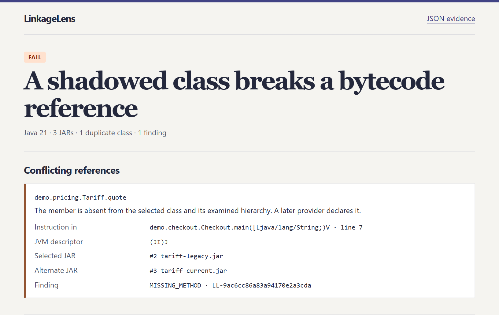

# LinkageLens

A Java service can compile against one version of a class and load another at startup. When a request finally calls the missing method, the JVM throws `NoSuchMethodError`. LinkageLens reads the JARs in launch order and connects the selected class to the exact bytecode instruction that expects a different member. The scan runs offline and never executes the application.

## See the failure

The checkout example compiles against `Tariff.quote(long, int)`. Its old pricing library also contains `demo.pricing.Tariff`, but only offers `quote(long)`. All three classpaths below use the same compiled checkout client.

| Pricing JARs after `checkout.jar`, in order | JVM running the example | LinkageLens |
| --- | --- | --- |
| `tariff-legacy.jar`, `tariff-current.jar` | Throws `NoSuchMethodError` in `Checkout.main` | **FAIL** · the selected class lacks `quote(JI)J` |
| `tariff-current.jar`, `tariff-legacy.jar` | Prints `Order total: 1080 cents` | **WARN** · two different definitions remain |
| `tariff-current.jar` | Prints `Order total: 1080 cents` | **PASS** · one provider |

The report identifies the call on line 7, the `invokevirtual` instruction and both archives. In the JVM descriptor `(JI)J`, the arguments are a `long` and an `int`, and the return type is `long`. [Checkout source](examples/checkout/client/demo/checkout/Checkout.java)



**Open a report now.** Extract the [checkout demo ZIP](https://github.com/Almeida96/linkagelens/releases/download/v0.1.0/checkout-demo.zip) and open `broken/report.html`. The archive also contains `reordered/report.html`, `fixed/report.html`, their JSON evidence and the three runnable JARs.

**Run the scanner.** Install Java 21 and extract the [LinkageLens CLI ZIP](https://github.com/Almeida96/linkagelens/releases/download/v0.1.0/linkagelens-0.1.0.zip). Run the demo from the extracted `linkagelens-0.1.0` directory.

```sh
./bin/linkagelens demo --out checkout-demo
```

On Windows PowerShell use `.\bin\linkagelens.bat demo --out checkout-demo`. The demo writes three fresh reports. These commands reproduce the exception and then run the fixed client on Linux or macOS.

```sh
cd checkout-demo/jars
java -cp 'checkout.jar:tariff-legacy.jar:tariff-current.jar' demo.checkout.Checkout
java -cp 'checkout.jar:tariff-current.jar' demo.checkout.Checkout
```

In PowerShell use `';'` as the Java classpath separator, for example `java -cp 'checkout.jar;tariff-current.jar' demo.checkout.Checkout`.

## Scan your deployment

Pass the application's JAR first, followed by its dependencies in the order used by its launcher. These examples run from the extracted CLI directory.

```sh
./bin/linkagelens scan --out release-review --target 17 \
  --jar dist/service.jar \
  --jar dist/lib/pricing-1.jar \
  --jar dist/lib/pricing-2.jar
```

For a long classpath, supply a UTF-8 text file with one path per line. Relative paths resolve from the directory containing the list. Entries are read in file order. Use a fresh output directory for each scan.

```sh
./bin/linkagelens scan --classpath-file checkout-demo/broken/classpath.txt --out checkout-review
```

The HTML report opens locally. The JSON includes artifact and class SHA-256 digests, the selected archive entry, alternative definitions, and a stable finding ID for each reported call site. Line numbers come from the class file and read `-1` when debug line information is absent.

| Scan exit code | Meaning |
| --- | --- |
| `0` | **PASS**, or **WARN** with the default settings. Identical duplicate class bytes alone can pass. |
| `1` | **FAIL** with evidence of a conflicting instruction, or **WARN** with `--strict`. Both produce reports. |
| `2` | Invalid input, unsupported selected class-file version, size limit or I/O error. See standard error. |

## Inspect evidence over MCP

Start the stdio server with a saved JSON report. It reads the report at startup. A reviewer can investigate the affected caller and compare JAR hashes without opening the original binaries. Replace both absolute paths in this example client configuration.

```json
{
  "mcpServers": {
    "linkagelens": {
      "command": "java",
      "args": [
        "-cp", "/opt/linkagelens-0.1.0/lib/*",
        "io.github.almeida96.linkagelens.Main",
        "mcp", "--report", "/work/checkout-demo/broken/report.json"
      ]
    }
  }
}
```

Ask *“Which JAR supplies the pricing class, and which line of checkout expects a method that it lacks?”* The four read-only tools expose the evidence for that answer.

| Tool | Example arguments | Evidence |
| --- | --- | --- |
| `linkage_summary` | `{}` | Verdict, Java target, artifact and finding counts, analysis statistics |
| `list_findings` | `{"owner":"demo.pricing.Tariff"}` | Caller, source line, opcode, target descriptor and artifact indices |
| `list_duplicates` | `{"limit":10}` | Duplicate binary names, selected artifact index, provider counts and byte equality |
| `inspect_duplicate` | `{"className":"demo.pricing.Tariff"}` | Ordered providers, filenames, selected entries and SHA-256 digests |

List and inspection responses support `offset` and `limit` (default 25, maximum 100). Follow `nextOffset` to read the next page.

## Scope

- Supply an explicit, ordered classpath of ordinary JAR files. For each binary name the earliest effective definition wins. Multi-release JARs with the manifest flag use the highest applicable versioned entry for `--target` (Java 8–21, default 21). Module-path resolution, nested executable JARs, manifest classpath expansion and custom class loaders are outside this model.
- LinkageLens inspects direct field and method instructions in winning class definitions. It reports a missing method or field, incompatible static/instance access, or a class/interface mismatch when a later provider directly declares the expected public member. Static scanning includes methods an application's workload may never call. A finding describes what can happen if control reaches that instruction.
- Analysis is scoped to references whose symbolic owner has differing class bytes. It checks supplied ancestors before reporting a missing member. Missing ancestors, certain platform methods, access-control cases and lookup limits can leave a reference inconclusive. The JSON records the count in `stats.inconclusiveReferences`. Reflection, dynamic invocation and framework-generated classes require separate investigation.
- The scan accepts up to 256 JARs, 1 GiB of input archives combined and 256 MiB of selected class bytes. Other limits include 4 MiB per class and 32 MiB per report. The report identifies classes, members and archive names, which may contain internal project details.

## Build and verify

Build the distribution with JDK 21 and the included Gradle wrapper.

```sh
./gradlew test installDist distZip
python checks/checkout_smoke.py --install-dir build/install/linkagelens
```

Use `.\gradlew.bat` on Windows. The smoke check runs the bundled checkout client on a real JVM in each of the three configurations and compares the outcome with the scanner's evidence.

The optional integration check downloads two pinned SLF4J artifacts, verifies their SHA-256 digests and compiles a client against version 2.0.17. It then runs the client with version 1.7.36 first on the classpath, checks the JVM's `NoSuchMethodError` for `Logger.atInfo()`, and compares it with the scanner's finding. The fluent logging methods first appeared in SLF4J 2.0. [Integration check](checks/slf4j_smoke.py) · [SLF4J manual](https://www.slf4j.org/manual.html#fluent)

```sh
python checks/slf4j_smoke.py --install-dir build/install/linkagelens
```

[MIT License](LICENSE)
